# Python Socket Library for Network Packet Sniffing

> **Course:** Network & Internet Security Sessional — **CYSE 228**
> **Lab Report:** 01
> **Student:** Aminul Hoque Imran — **ID:** 2304027
> **Department:** Cyber Security Engineering
> **University:** University of Frontier Technology, Bangladesh (UFTB)

A Python-based network packet sniffer that captures live traffic on Linux using the
**Socket** and **Struct** libraries, and decodes **Ethernet**, **IPv4**, **ICMP** and
**TCP** headers in real time.

---

## 1. Project Introduction

A network packet sniffer is a software tool used to watch, capture and inspect
network traffic. It gives the user visibility into the data packets travelling
through a network. Packet sniffers are commonly used for network management,
troubleshooting, performance monitoring and security research.

In this project a network packet sniffer was built using **Python** and the
**Socket** library on **Kali Linux**. The program captures real-time network
packets and extracts details about the **Ethernet**, **IPv4**, **ICMP** and
**TCP** layers.

---

## 2. Objectives

- Capture network traffic so data flow becomes visible.
- Learn Python socket programming in order to build custom tools.
- Analyze Ethernet frames to understand machine-to-machine communication.
- Extract MAC addresses to identify devices on the network.
- Unpack IPv4 headers to read routing information.
- Analyze ICMP packets to debug network problems.
- Analyze TCP segments to inspect session data.
- Display packet data in a readable, formatted way.

---

## 3. Features

- **Ethernet frame analysis** — destination MAC, source MAC and protocol/EtherType.
- **MAC address formatting** — raw 6-byte values rendered as `AA:BB:CC:DD:EE:FF`.
- **IPv4 header parsing** — version, header length, TTL, protocol, source and destination IP.
- **ICMP packet analysis** — type, code and checksum (e.g. `ping` Echo Requests/Replies).
- **TCP segment analysis** — source/destination ports, sequence & acknowledgment numbers, control flags (URG, ACK, PSH, RST, SYN, FIN) and header offset.
- **Real-time packet capture** — a continuous `recvfrom` loop.
- **Malformed-packet safety** — truncated/invalid frames are skipped with a warning instead of crashing the capture loop.
- **Readable packet display** — structured, human-friendly console output.

---

## 4. Technologies Used

| Technology | Purpose |
|---|---|
| **Python 3** | Core programming language. |
| **`socket`** | Creating raw sockets and capturing packets (`AF_PACKET`, `SOCK_RAW`). |
| **`struct`** | Unpacking raw packet headers (byte sequences) into readable fields. |
| **Kali Linux** (VirtualBox) | The testing environment where live capture is performed as root. |
| **`unittest`** (offline tests) | Stdlib-only test suite for the parsers (`tests/test_offline_parsers.py`). |

> No third-party packages are required — only the Python standard library.

---

## 5. Project Structure

```
Python-Socket-Network-Packet-Sniffer/
│
├── README.md                       # This file
├── requirements.txt                # Stdlib-only note (no external deps)
├── .gitignore                      # Python / OS junk exclusions
│
├── assignment/
│   └── original_lab_report.pdf     # The submitted lab report (kept intact)
│
├── src/
│   └── sniffer.py                  # The packet sniffer program
│
├── tests/
│   └── test_offline_parsers.py     # Offline parser tests (no socket, no root)
│
├── screenshots/
│   ├── 00_cover.png
│   ├── 01_project_setup.png
│   ├── … (15 images extracted from the original PDF)
│   └── 14_results_output.png
│
└── docs/
    └── project_documentation.md    # Detailed technical documentation
```

---

## 6. Installation and Setup

The project environment was prepared using **Oracle VirtualBox** + **Kali Linux**.

1. Launch the Kali Linux virtual machine.
2. Open a terminal and verify the working directory and Python version:

   ```bash
   pwd
   python3 --version
   ```

3. Create and enter the project directory:

   ```bash
   mkdir PacketSniffer
   cd PacketSniffer
   ```

4. Create the Python file and paste the source from `src/sniffer.py`:

   ```bash
   nano sniffer.py
   ```

Because the project relies only on the Python standard library, there is nothing
else to install.

> A raw `AF_PACKET` socket requires **root** privileges, so the program must be
> started with `sudo` (see below).

---

## 7. Execution Instructions

1. Run the sniffer with root privileges:

   ```bash
   sudo python3 sniffer.py
   ```

2. In a **second terminal**, generate traffic so packets appear:

   ```bash
   ping 8.8.8.8
   ```

The sniffer continuously captures frames (`while True:` → `conn.recvfrom(65536)`)
and prints the decoded Ethernet / IPv4 / ICMP / TCP information for each one.

### Offline tests (no Linux root needed)

The parser logic is covered by a stdlib-only test suite that never opens a
socket, so it can be run on any OS:

```bash
python3 tests/test_offline_parsers.py
```

---

## 8. Explanation of Packet Analysis

### Ethernet Frame Analysis (Layer 2)
The sniffer captures Layer 2 headers and extracts the **Destination MAC**,
**Source MAC** and **Protocol / EtherType** fields. Captured traffic includes:

- `FF:FF:FF:FF:FF:FF` — Layer 2 **broadcast** (every device receives it).
- `01:00:5E:…` — **IPv4 multicast** (commonly mDNS).
- `33:33:…` — **IPv6 multicast** (commonly mDNS).
- Non-standard protocol numbers (e.g. `1544`, `39065`) indicate proprietary or
  direct Ethernet payload framing created during local socket operations.

The `ethernet_frame()` function uses
`struct.unpack('! 6s 6s H', data[:14])` to split the first 14 bytes into
Destination MAC (6 bytes), Source MAC (6 bytes) and Protocol (2 bytes).
`get_mac_addr()` converts each raw byte into two hex digits
(`map("{:02x}".format, …)`), joins them with colons and upper-cases the result.

### IPv4 Packet Unpacking (Layer 3)
The program extracts: **Version**, **Header Length**, **TTL**, **Protocol
Number**, **Source IP** and **Destination IP**.

Example output (from the lab report):

```
Version : 4
Header Length : 20
TTL : 64
Protocol : 1
Source IP : 10.0.2.15
Destination IP : 8.8.8.8
```

### ICMP Packet Analysis (Layer 3 / control)
ICMP is the protocol used by `ping`. Its protocol number is **1**. The sniffer
extracts **Type**, **Code** and **Checksum**.

Example output (from the lab report):

```
ICMP Packet
Type : 8
Code : 0
Checksum : 41737
```

Interpretation: `8` = Echo Request, `0` = Echo Reply, `3` = Destination
Unreachable.

### TCP Segment Analysis (Layer 4)
The TCP module extracts the **source port**, **destination port**,
**sequence number**, **acknowledgment number** and the **control flags**
**URG, ACK, PSH, RST, SYN, FIN**. It computes the **TCP header offset** to find
where the payload begins, then treats the remaining bytes as the TCP payload —
separating header information from transmitted data.

### Malformed / Truncated Packet Handling
Every parser checks the minimum header length before unpacking (14 bytes for
Ethernet, 20 for IPv4, 4 for ICMP, 14 for TCP) and raises a clear error for
truncated data. The capture loop catches these errors, prints a warning and
continues capturing instead of crashing.

---

## 9. Sample Output

Running `sudo python3 sniffer.py` while `ping 8.8.8.8` runs in another terminal
produces output such as:

```
Network Packet Sniffer Started
Listening on all interfaces (Ctrl+C to stop)...

============================================================
Ethernet Frame:
  Destination MAC : FF:FF:FF:FF:FF:FF
  Source MAC      : 00:E2:69:3D:13:D2
  Protocol        : 2054 (0x0806)
ARP Packet

============================================================
Ethernet Frame:
  Destination MAC : 9A:07:D9:E7:C8:FD
  Source MAC      : 00:E2:69:3D:13:D2
  Protocol        : 2048 (0x0800)
IPv4 Packet:
  Version        : 4
  Header Length  : 20
  TTL            : 64
  Protocol       : 1
  Source IP      : 10.0.2.15
  Destination IP : 8.8.8.8
ICMP Packet:
  Type     : 8
  Code     : 0
  Checksum : 41737
```

(The exact MAC/IP values depend on the local network; the structure above follows
the report's documented behaviour.)

---

## 10. Screenshots

All images below are extracted directly from the submitted lab report
(`assignment/original_lab_report.pdf`) — none are fabricated.

### Report cover


### Project setup (Kali Linux + VirtualBox)
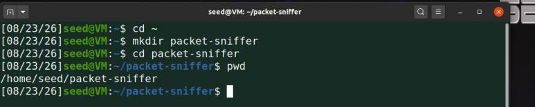

### Creating the Python file / writing code
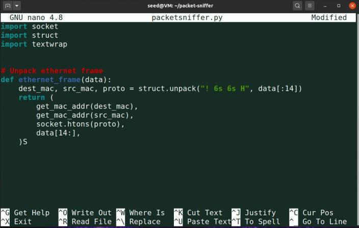

### Importing socket & struct / Python code
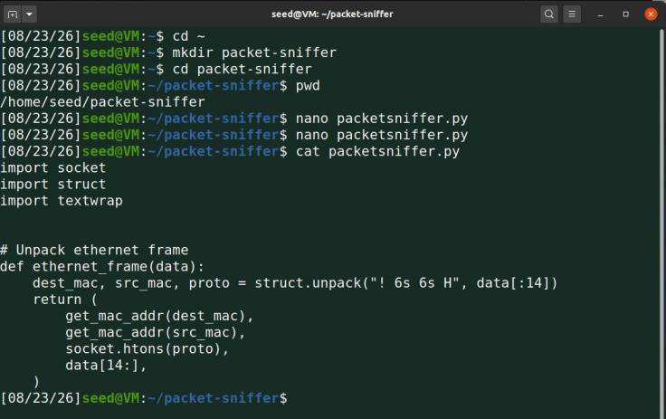

### Raw socket creation
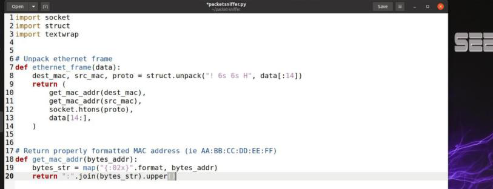

### Capture loop (recvfrom)
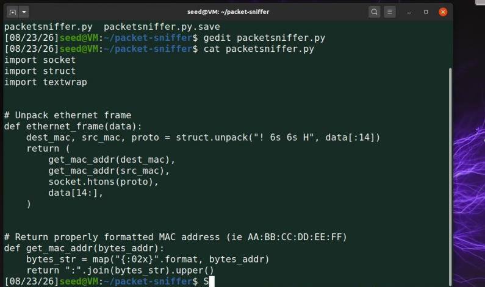

### Packet capture running
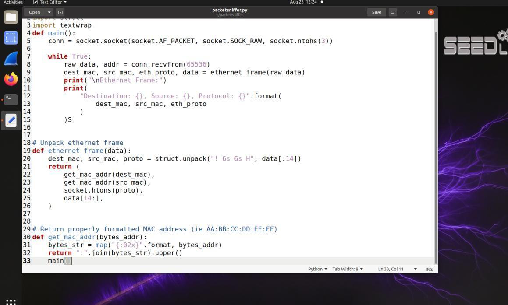

### Generating traffic (ping)
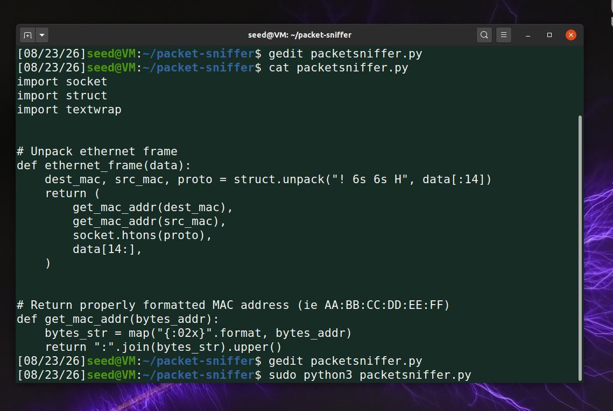

### Ethernet frame analysis
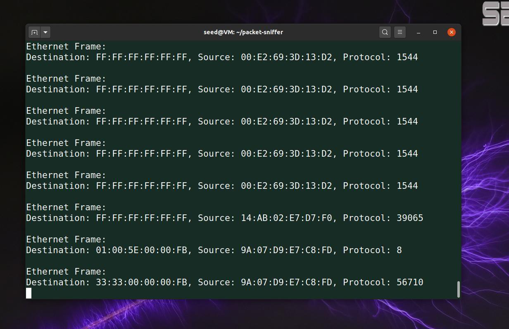

### IPv4 analysis
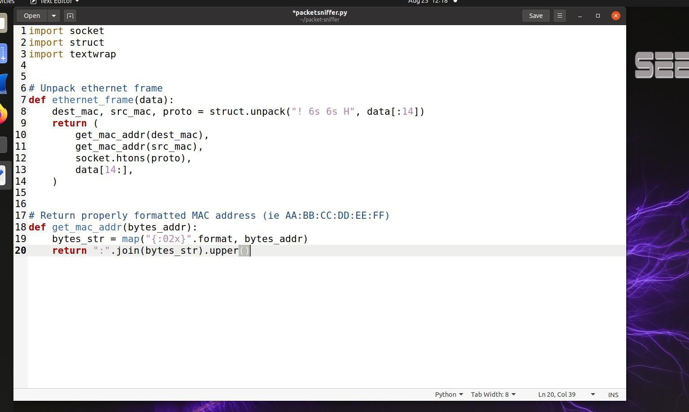

### ICMP analysis


### TCP analysis
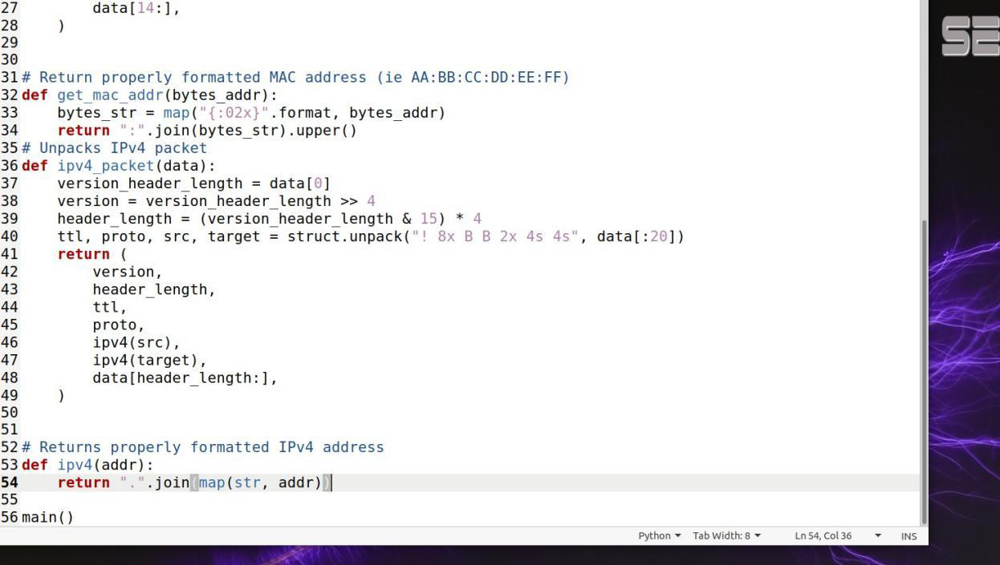

### Running the program
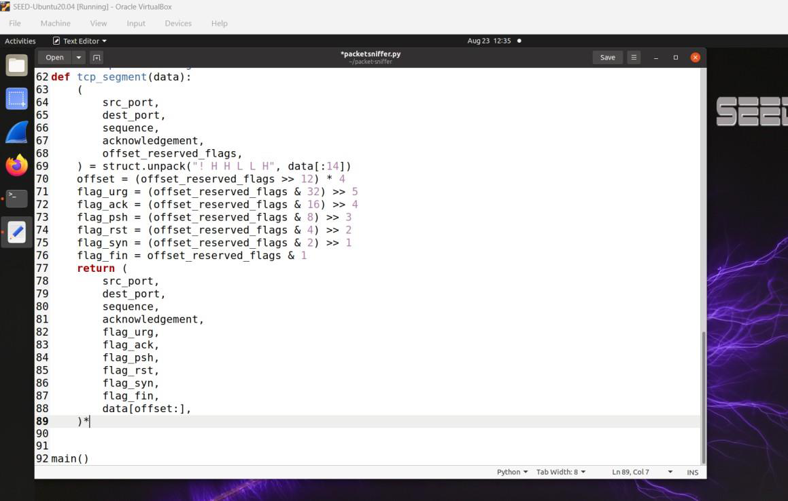
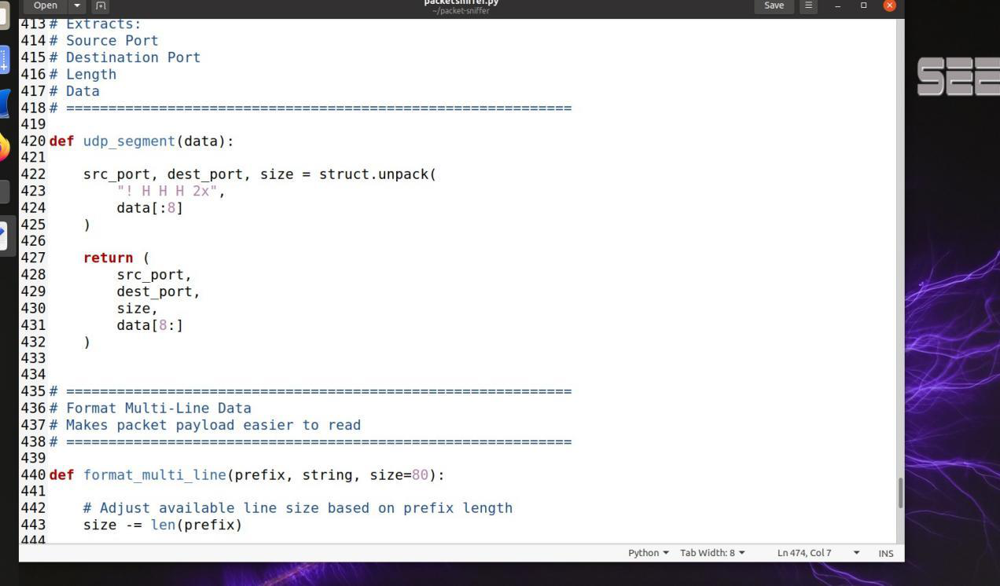

### Results / output
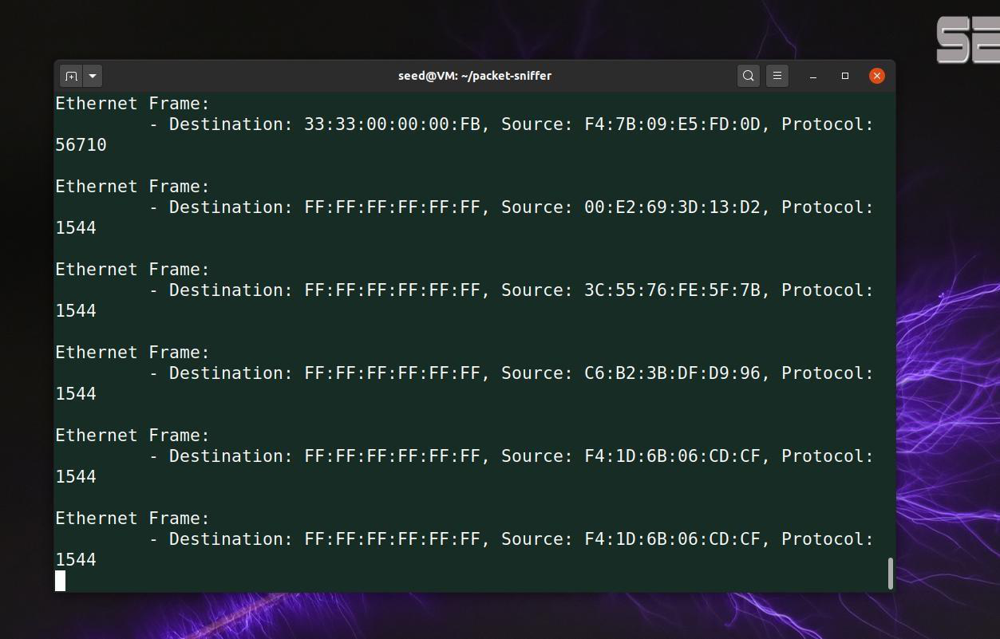

---

## 11. Results

As documented in the lab report, the program:

- Captured live network traffic.
- Extracted Ethernet frame information.
- Formatted MAC addresses.
- Parsed IPv4 packet headers.
- Analyzed ICMP packets.
- Analyzed TCP segments.
- Displayed packet information in real time.

The repeated `Ethernet Frame` messages confirm the sniffer is continuously
monitoring the network and capturing frames as they arrive.

---

## 12. Limitations

- **Root required:** opening an `AF_PACKET` raw socket needs administrator/root
  privileges (`sudo`).
- **Linux only:** `AF_PACKET` is a Linux-specific socket family; the script will
  not run on Windows or macOS without modification.
- **Link-layer only:** it decodes Ethernet → IPv4 → ICMP/TCP; it does not yet
  decode ARP, IPv6, UDP payloads or application-layer protocols in depth.
- **No packet filtering / saving:** it prints to the console and does not write
  `.pcap` files or apply BPF filters.
- **Report samples are illustrative:** exact MAC/IP values depend on the local
  network at capture time.

---

## 13. Troubleshooting

| Problem | Likely cause & fix |
|---|---|
| `PermissionError` / `Permission denied` on startup | Raw sockets need root: run with `sudo python3 sniffer.py`. |
| `AttributeError: module 'socket' has no attribute 'AF_PACKET'` | You are not on Linux (e.g. Windows/macOS). `AF_PACKET` is Linux-only — run inside the Kali Linux VM. |
| Program runs but prints nothing | Generate traffic in a second terminal (`ping 8.8.8.8`), or open a website in the VM's browser. |
| No packets from other devices | In VirtualBox, NAT mode only shows the VM's own traffic; use a bridged adapter to see more of the LAN (with instructor permission). |
| `[!] Skipped malformed frame (...)` warnings | Normal behaviour: a truncated/damaged frame arrived and was safely skipped — the sniffer keeps running. |
| `ModuleNotFoundError` for `sniffer` when running tests | Run tests from the repository root: `python3 tests/test_offline_parsers.py`. |
| Old Python 2 errors (`print` syntax) | Use Python 3: `python3 --version` should be ≥ 3.7. |

---

## 14. Academic Information

| Field | Detail |
|---|---|
| **Student Name** | Aminul Hoque Imran |
| **Student ID** | 2304027 |
| **Year / Semester** | 2nd Year, 2nd Semester |
| **Department** | Cyber Security Engineering (CySE) |
| **University** | University of Frontier Technology, Bangladesh (UFTB) |
| **Course** | Network & Internet Security Sessional |
| **Course Code** | CYSE 228 |
| **Lab Report No.** | 01 |
| **Submitted To** | Md Masud Rana, Lecturer, Dept. of CySE, UFTB |

---

## 15. Reconstruction Disclaimer

The original lab report PDF (`assignment/original_lab_report.pdf`) contains only
**code fragments** (imports, the raw socket call, the `struct` formats, function
names and sample outputs) — not the complete program. `src/sniffer.py` in this
repository is therefore a **faithful reconstruction** assembled strictly from
those fragments and is provided for reference/review. It is **not claimed to be
the student's exact original file**. Minimum-length guards and safe payload
slicing were added so malformed frames cannot crash the capture loop; all logic
from the report's fragments is unchanged. If you have the original `sniffer.py`,
replace `src/sniffer.py` with it and the rest of the repository remains valid.
